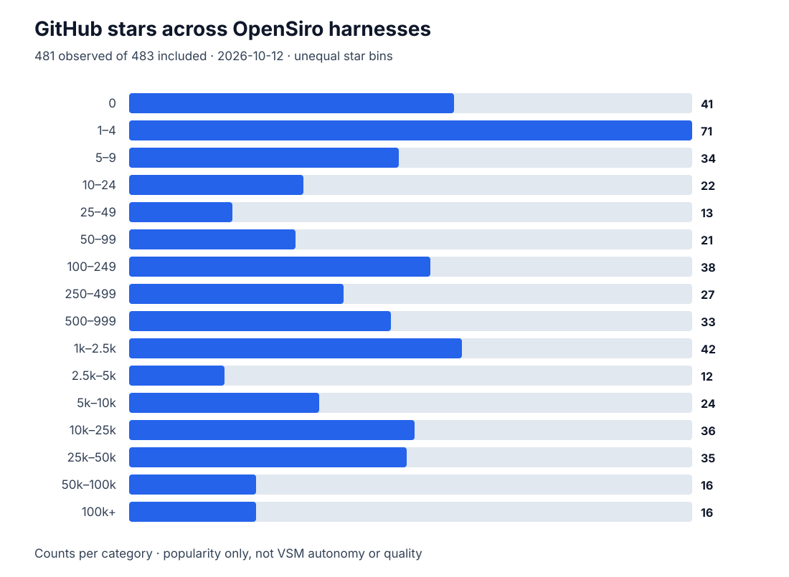

# GitHub star distribution (non-canonical)



A **point-in-time external popularity snapshot**, not an autonomy score, quality
rating, VSM ownership measurement, or admission criterion. GitHub stars change,
and GitHub popularity is neither an assessment criterion nor evidence of S1–S5.

- Included-cohort boundary: `data/catalog.psv` joined to `data/signatures.psv`
  at commit `a7c59ff1e31797fecb7230dc6eb2292f5df1029d`. Proposed and excluded rows are not counted.
- GitHub observation window (UTC): 2026-10-11T18:13:11Z to 2026-10-11T18:15:03Z.
- Included: **453**; observed: **452**;
  unavailable: **1** (shown as missing, *not* zero).
- Median: **281.0** stars; mean: **13 414** stars.
- Under 10: **125** (27.7%);
  under 100: **181** (40.0%);
  at least 10,000: **98** (21.7%).
- Unavailable repository: [korus](https://github.com/surefire-ai/korus).

## Histogram

| GitHub stars (bin) | Harnesses | Share of observed |
| --- | ---: | ---: |
| 0 | 38 | 8.4% |
| 1–4 | 56 | 12.4% |
| 5–9 | 31 | 6.9% |
| 10–24 | 22 | 4.9% |
| 25–49 | 13 | 2.9% |
| 50–99 | 21 | 4.6% |
| 100–249 | 37 | 8.2% |
| 250–499 | 26 | 5.8% |
| 500–999 | 33 | 7.3% |
| 1k–2.5k | 41 | 9.1% |
| 2.5k–5k | 12 | 2.7% |
| 5k–10k | 24 | 5.3% |
| 10k–25k | 34 | 7.5% |
| 25k–50k | 32 | 7.1% |
| 50k–100k | 16 | 3.5% |
| 100k+ | 16 | 3.5% |

Bins are **unequal-width categories**; bars show the number of projects in
each category, not a density and not a continuous linear-scale histogram.
The external snapshot is machine-readable at
[`data/github-stars.json`](../data/github-stars.json).

## Refresh and validation

```bash
python scripts/github_stars.py refresh   # network required; uses GITHUB_TOKEN if set
python scripts/github_stars.py render    # offline, from committed snapshot
python scripts/github_stars.py check     # offline; fails if generated outputs drift
python -m unittest tests/test_github_stars.py
```

`refresh` uses GitHub REST API with `GITHUB_TOKEN`, otherwise public GitHub
repository pages. A 404 records `stars: null`, never zero; transient/API
errors **fail the refresh** rather than silently producing partial data.
The source revision and UTC observation window are pinned in the snapshot.
Scheduled refresh automation proposes a separate PR for review; it does not
edit canonical VSM assessments or the main branch directly.
