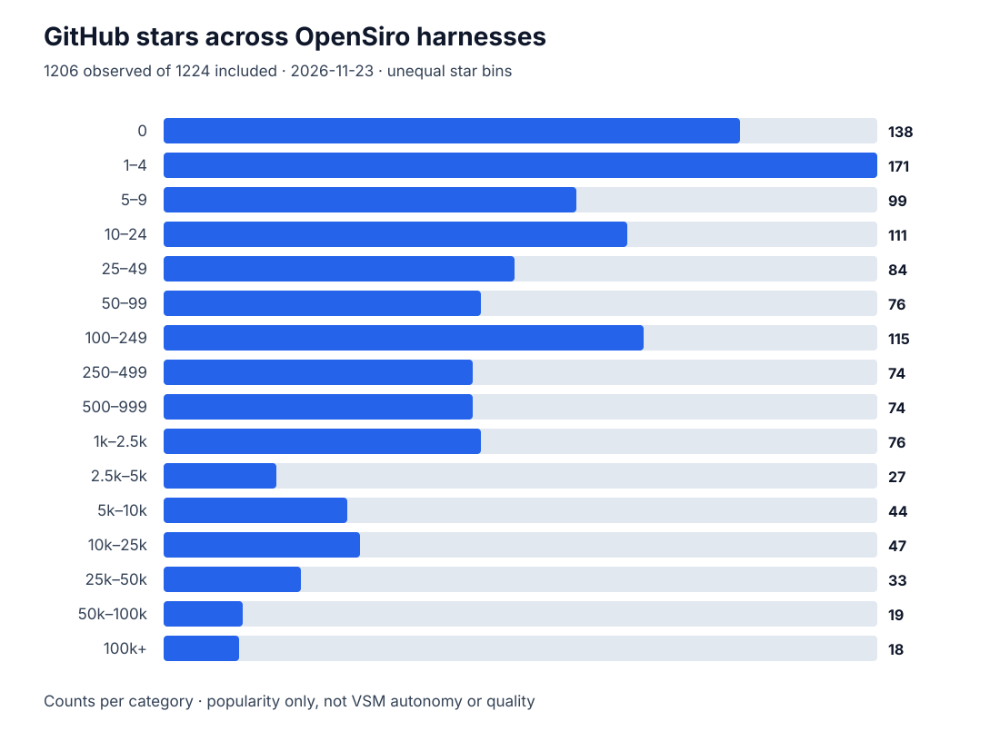

# GitHub star distribution (non-canonical)



A **point-in-time external popularity snapshot**, not an autonomy score, quality
rating, VSM ownership measurement, or admission criterion. GitHub stars change,
and GitHub popularity is neither an assessment criterion nor evidence of S1–S5.

- Included-cohort boundary: `data/catalog.psv` joined to `data/signatures.psv`
  at commit `854c6e5441709b014c01f803c23311fdf366a354`. Proposed and excluded rows are not counted.
- GitHub observation window (UTC): 2026-11-16T13:36:23Z to 2026-11-16T13:37:17Z.
- Included: **1 120**; observed: **1 105**;
  unavailable: **15** (shown as missing, *not* zero).
- Median: **55** stars; mean: **6 521** stars.
- Under 10: **377** (34.1%);
  under 100: **606** (54.8%);
  at least 10,000: **116** (10.5%).
- Unavailable repository: [headcount](https://github.com/cbrock84/headcount), [veritas](https://github.com/matiasrodlo/veritas), [korus](https://github.com/surefire-ai/korus), [codehamr](https://github.com/plaxtoris/codehamr), [visvoai](https://github.com/VisvoAI/visvoai), [shelracode](https://github.com/Shelra/ShelraCode), [qcode](https://github.com/fwtllh-png/QCode), [gopi](https://github.com/cgund98/gopi), [dtadpole-heddle](https://github.com/dtadpole/heddle), [setup-ai-core](https://github.com/kartalbas/setup-ai-core), [inkpi](https://github.com/MeiSiristhebest/inkpi), [agent-harness-cmabery](https://github.com/CMABERY/agent-harness), [gifford](https://github.com/smellak/gifford), [rubin-johnson-maestro](https://github.com/rubin-johnson/maestro), [quickcode](https://github.com/devincii-io/QuickCode).

## Histogram

| GitHub stars (bin) | Harnesses | Share of observed |
| --- | ---: | ---: |
| 0 | 134 | 12.1% |
| 1–4 | 158 | 14.3% |
| 5–9 | 85 | 7.7% |
| 10–24 | 94 | 8.5% |
| 25–49 | 74 | 6.7% |
| 50–99 | 61 | 5.5% |
| 100–249 | 107 | 9.7% |
| 250–499 | 68 | 6.2% |
| 500–999 | 65 | 5.9% |
| 1k–2.5k | 74 | 6.7% |
| 2.5k–5k | 25 | 2.3% |
| 5k–10k | 44 | 4.0% |
| 10k–25k | 46 | 4.2% |
| 25k–50k | 33 | 3.0% |
| 50k–100k | 19 | 1.7% |
| 100k+ | 18 | 1.6% |

Bins are **unequal-width categories**; bars show the number of projects in
each category, not a density and not a continuous linear-scale histogram.
The external snapshot is machine-readable at
[`data/github-stars.json`](../data/github-stars.json).

## Refresh and validation

```bash
python scripts/github_stars.py refresh   # network required; uses GITHUB_TOKEN if set
python scripts/github_stars.py render    # offline, from committed snapshot
python scripts/github_stars.py check     # offline; fails if generated outputs drift
python -m unittest tests/test_github_stars.py
```

`refresh` uses GitHub REST API with `GITHUB_TOKEN`, otherwise public GitHub
repository pages. A 404 records `stars: null`, never zero; transient/API
errors **fail the refresh** rather than silently producing partial data.
The source revision and UTC observation window are pinned in the snapshot.
Scheduled refresh automation proposes a separate PR for review; it does not
edit canonical VSM assessments or the main branch directly.
