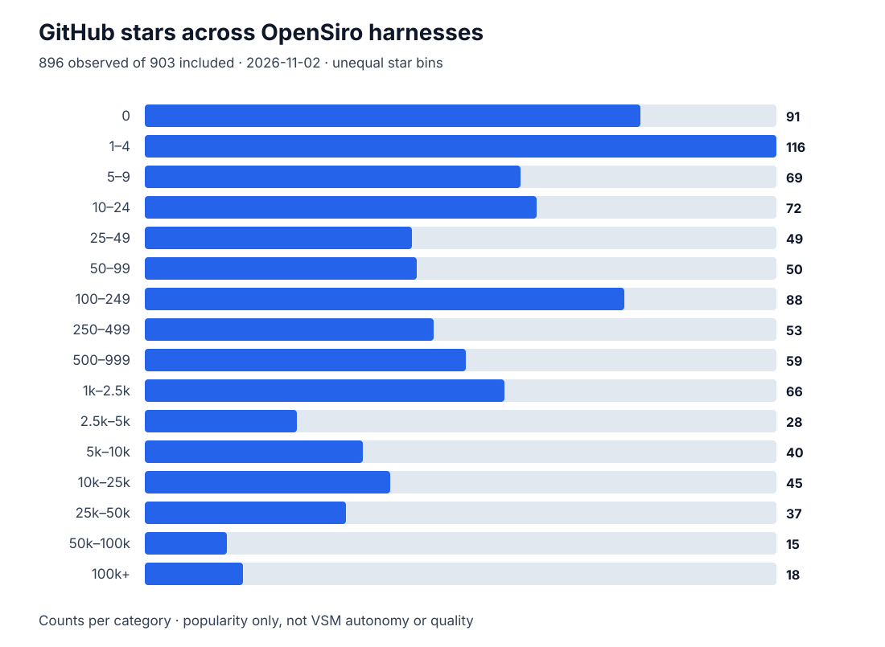

# GitHub star distribution (non-canonical)



A **point-in-time external popularity snapshot**, not an autonomy score, quality
rating, VSM ownership measurement, or admission criterion. GitHub stars change,
and GitHub popularity is neither an assessment criterion nor evidence of S1–S5.

- Included-cohort boundary: `data/catalog.psv` joined to `data/signatures.psv`
  at commit `1c021299b02811b5e34a4b01833cdba494fca0b3`. Proposed and excluded rows are not counted.
- GitHub observation window (UTC): 2026-11-02T13:28:31Z to 2026-11-02T13:29:11Z.
- Included: **903**; observed: **896**;
  unavailable: **7** (shown as missing, *not* zero).
- Median: **103.0** stars; mean: **7 851** stars.
- Under 10: **276** (30.8%);
  under 100: **447** (49.9%);
  at least 10,000: **115** (12.8%).
- Unavailable repository: [veritas](https://github.com/matiasrodlo/veritas), [korus](https://github.com/surefire-ai/korus), [visvoai](https://github.com/VisvoAI/visvoai), [shelracode](https://github.com/Shelra/ShelraCode), [qcode](https://github.com/fwtllh-png/QCode), [gopi](https://github.com/cgund98/gopi), [setup-ai-core](https://github.com/kartalbas/setup-ai-core).

## Histogram

| GitHub stars (bin) | Harnesses | Share of observed |
| --- | ---: | ---: |
| 0 | 91 | 10.2% |
| 1–4 | 116 | 12.9% |
| 5–9 | 69 | 7.7% |
| 10–24 | 72 | 8.0% |
| 25–49 | 49 | 5.5% |
| 50–99 | 50 | 5.6% |
| 100–249 | 88 | 9.8% |
| 250–499 | 53 | 5.9% |
| 500–999 | 59 | 6.6% |
| 1k–2.5k | 66 | 7.4% |
| 2.5k–5k | 28 | 3.1% |
| 5k–10k | 40 | 4.5% |
| 10k–25k | 45 | 5.0% |
| 25k–50k | 37 | 4.1% |
| 50k–100k | 15 | 1.7% |
| 100k+ | 18 | 2.0% |

Bins are **unequal-width categories**; bars show the number of projects in
each category, not a density and not a continuous linear-scale histogram.
The external snapshot is machine-readable at
[`data/github-stars.json`](../data/github-stars.json).

## Refresh and validation

```bash
python scripts/github_stars.py refresh   # network required; uses GITHUB_TOKEN if set
python scripts/github_stars.py render    # offline, from committed snapshot
python scripts/github_stars.py check     # offline; fails if generated outputs drift
python -m unittest tests/test_github_stars.py
```

`refresh` uses GitHub REST API with `GITHUB_TOKEN`, otherwise public GitHub
repository pages. A 404 records `stars: null`, never zero; transient/API
errors **fail the refresh** rather than silently producing partial data.
The source revision and UTC observation window are pinned in the snapshot.
Scheduled refresh automation proposes a separate PR for review; it does not
edit canonical VSM assessments or the main branch directly.
